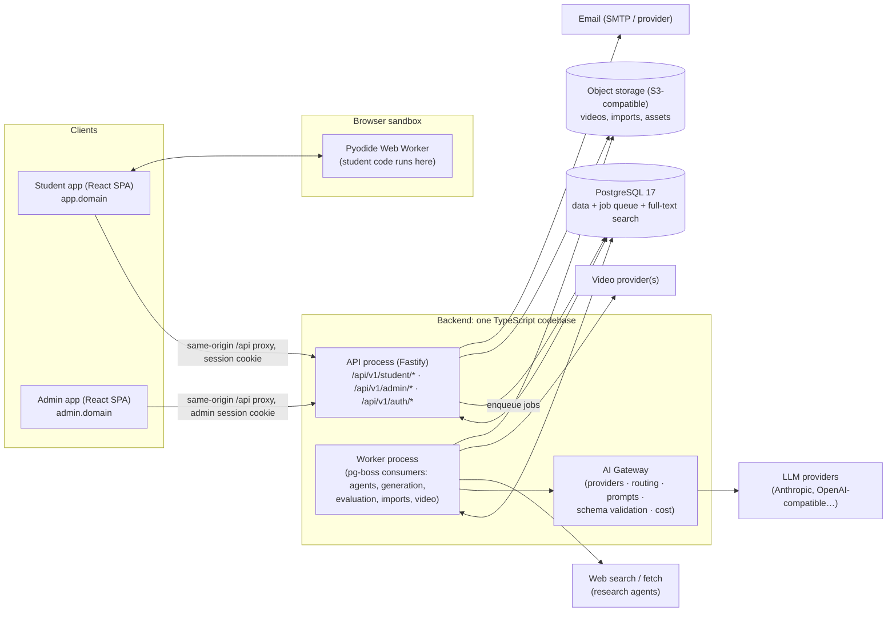

# 02 · System Architecture

## 1. Architecture at a glance

**Style:** a *modular monolith* backend (one codebase, strict domain modules) deployed as two processes, an **API** and a **Worker**, plus two separate single-page frontends (**Student app** and **Admin app**) and PostgreSQL as the system of record.



### Why this shape
- **A modular monolith, not microservices.** A small team needs one deployable unit, one transaction boundary and one place to debug. The domain modules talk through service interfaces, never through each other's tables, so any module (e.g. the AI worker) can be split out later without a rewrite.
- **API and Worker as separate processes** keep slow, failure-prone AI, video and import work off the request path. They scale independently and can be restarted without dropping user traffic.
- **Two separate frontends.** The admin bundle is never shipped to students, admin can be hosted on a restricted domain or network, and each app has its own session cookie. The backend still enforces everything; the split is defense in depth, not the defense.
- **Postgres as both database and queue (pg-boss)** removes Redis from the MVP. Jobs are enqueued in the same transaction as the data that triggers them, which makes them exactly-once-safe, and our job volume (admin-triggered) is tiny. Redis can be added later for caching and rate-limit state when we run multiple API instances.
- **Student code never runs on our servers.** In the MVP it runs in the student's browser via WebAssembly (Pyodide inside a Web Worker). A server-side sandbox comes later for graded assessments, behind the same `CodeRunner` interface.

---

## 2. Components and responsibilities

| Component | Responsibilities | Must never |
|---|---|---|
| **Student app** | Onboarding, dashboard, roadmap, lesson player, practice, progress, profile. Renders structured content through `@app/learning-ui`. Runs Pyodide for code. | Contain admin code, secrets or answers to unsubmitted questions |
| **Admin app** | Catalog, curriculum, CMS with live preview (same renderer), agents and jobs, question bank, students, analytics, AI config | Be reachable with a student session |
| **API** | AuthN/AuthZ, validation, domain services, depth resolution, planner, retrieval, grading, enqueueing jobs, audit | Call LLMs on the request path (except tiny, bounded admin utilities) |
| **Worker** | Executes jobs: transactional email (queued by the API, retried with backoff), content generation and evaluation, section regeneration, research, explore, curriculum, question import, video. Logs, retries, records cost | Publish content (it only produces drafts and reports) |
| **AI Gateway** (library used by the worker) | Provider adapters, task → model routing, prompt registry, structured output and validation, retries and fallbacks, usage and cost records | Leak keys to clients, or persist unvalidated output |
| **PostgreSQL** | All state, the pg-boss queue, full-text search (`tsvector`), trigram similarity (`pg_trgm`) for duplicate detection, `pgvector` later | – |
| **Object storage** | Video files, thumbnails, import uploads, generated images | Be public by default (served via signed URLs or a CDN) |

---

## 3. Backend module map

```
apps/api/src/modules/
  auth/          sessions, passwords, verification, reset, guards
  users/         student & admin profiles, admin invites
  catalog/       career roles, package brackets, depth levels, skill areas, difficulty policy
  curriculum/    topics, subtopics, prerequisites (DAG), role×bracket curriculum versions
  goals/         onboarding, student goals, skill self-ratings
  roadmap/       planner engine (pure), roadmap versions, proposals
  content/       learning modules, versions, section revisions, reviews, publishing, depth resolution
  learning/      lesson delivery, progress, knowledge-check grading, learning events
  questions/     question bank, import pipeline, taxonomy aliases, duplicates
  practice/      retrieval, attempts, grading, practice stats, revisit recommendations
  agents/        job orchestration, explore / research / curriculum / content / evaluation agents
  ai/            gateway, providers, model routes, prompts, usage & cost
  video/         video assets, provider adapters (Phase 7)
  analytics/     admin metrics & student tracking queries
  audit/         audit log
  settings/      platform settings & publishing policy
```

**Dependency rules.**
- Modules expose a `*.service.ts` API, and other modules import services, never another module's Prisma models directly.
- *Pure engines* (depth resolution, planner, retrieval scoring, import validation) live in `*.engine.ts` with **no I/O**. That keeps them fully unit-testable.
- Routes are thin: validate, authorize, call the service, map to a DTO.

---

## 4. Technology stack

| Layer | Choice | Why this, for this product | Alternatives considered |
|---|---|---|---|
| Language | **TypeScript 5.9** (strict), everywhere | One language across the API, worker and both SPAs. The **content schema and API contracts are defined once (Zod)** and shared by the generator, validator, API and renderer, which directly serves the "content generation separate from rendering" requirement. | Python backend (FastAPI). Strong for ML, but needs codegen to share schemas with the frontend. We call LLM APIs, we don't train models, so TS SDKs are first-class. |
| Runtime | **Node.js 24 LTS** | Current LTS, long support window | Bun / Deno: smaller ecosystem for Prisma and pg-boss in production |
| HTTP framework | **Fastify 5** | Fast, schema-first, mature plugins (cookie, helmet, rate-limit, multipart, swagger), first-class TS, `inject()` for fast API tests | Express (slower, weaker typing), NestJS (heavy DI and decorator boilerplate for a small team), Hono (great, but a thinner Node plugin ecosystem) |
| Validation and contracts | **Zod 4** | Runtime validation and static types from one definition. Native JSON Schema export for LLM structured outputs and OpenAPI. | Yup / Joi (no JSON Schema story), TypeBox |
| Database | **PostgreSQL 17** | Relational integrity for a heavily linked taxonomy, JSONB for flexible content bodies, full-text search, `pg_trgm` (duplicates), `pgvector` (semantic, later), and it is also our queue | MongoDB (weak relational integrity for curriculum and tag joins) |
| ORM and migrations | **Prisma 7** (`prisma-client` generator + `@prisma/adapter-pg`) | Readable schema that doubles as documentation, reliable migrations, typed queries. v7 drops the Rust engine (smaller, faster cold start). | Drizzle: excellent, closer to SQL, but a less mature migration workflow for a team new to the codebase |
| Background jobs | **pg-boss** | Postgres-backed queue: retries, backoff, scheduling, singleton jobs, transactional enqueue. No extra infrastructure. | BullMQ + Redis (another stateful service to run), Temporal (overkill for the MVP) |
| Auth | **In-house session auth**: opaque random tokens, SHA-256-hashed in DB, HttpOnly cookies, **Argon2id** (`@node-rs/argon2`) | Full control of the student/admin audience split, revocation and audit. A small, well-understood surface following OWASP guidance. No per-user SaaS cost. | Auth0 / Clerk (cost per MAU, data residency), Better Auth (good, but adds a large dependency for a small surface), JWTs (hard to revoke; not needed with same-origin cookies) |
| Frontend | **React 19 + Vite 8** SPAs | Logged-in apps don't need SSR or SEO. Static builds deploy to any CDN. Very fast dev server and builds. | Next.js (SSR complexity plus cookie forwarding to a separate API, with no SEO benefit behind login). A marketing site can be separate later. |
| Routing / data | **React Router 7**, **TanStack Query 5** | Mature. Query gives caching, retries, optimistic progress updates. | Redux (unneeded global state) |
| Styling / UI | **Tailwind CSS 4** + design tokens (CSS variables) + **Radix UI** primitives + **Motion** + **lucide** icons | Fast to build a distinctive design system (not a template). Radix provides accessible dialogs, tabs and menus. Motion handles subtle transitions and respects reduced motion. | MUI / Chakra (generic "dashboard template" look, heavier) |
| Code editor | **CodeMirror 6** | Lightweight, **works on mobile**, extensible languages | Monaco (heavy, poor on mobile) |
| Code execution (MVP) | **Pyodide** (CPython on WebAssembly) in a Web Worker | Executes Python with NumPy / pandas / scikit-learn **in the student's browser**, zero server risk and zero compute cost. Timeouts by terminating the worker. Network disabled in the worker. | Judge0 / Piston / Docker+gVisor / E2B. Needed later for graded assessments and other languages, so they sit behind the same `CodeRunner` interface. |
| Diagrams | Structured diagram JSON → our own SVG renderer (auto-layout via dagre), step-by-step highlights | LLMs produce node/edge JSON reliably. Themeable, animatable and accessible, unlike pasted images. | Mermaid (a fallback type: generic look, hard to animate step by step) |
| AI SDKs | `@anthropic-ai/sdk`, `openai` (OpenAI-compatible endpoints) **behind our gateway** | Official SDKs. The gateway keeps business logic provider-agnostic. | LangChain / LangGraph: heavy abstraction and lock-in. The spec says no framework dependency. |
| Email | `nodemailer` (SMTP). **Mailpit** in dev | Works with any provider (SES, SendGrid, Postmark) | Provider SDK lock-in |
| Testing | **Vitest 4**, Testing Library, Fastify `inject`, **Playwright** (E2E) | Fast, TS-native, one runner for everything | Jest (slower with ESM and TS) |
| Lint / format | **Biome 2** | One fast tool for lint and format. No dependency on the TypeScript JS API. | ESLint + Prettier (two tools, more config) |
| Dev infra | **Docker Compose**: Postgres, Mailpit (later MinIO) | One-command local setup | Local installs |

**Version policy.** Pin to mature majors (≥ ~3 months old) with lockfile-pinned exact versions. Renovate keeps them updated after launch. Bleeding-edge majors (TypeScript 7 native, Prisma 8 RC, Vite-ecosystem RCs) are deliberately avoided for now.

---

## 5. Security architecture

| Concern | Design |
|---|---|
| **Passwords** | Argon2id (OWASP parameters: m=19 MiB, t=2, p=1). Minimum 8 characters, rejects very common passwords, max 128 characters. |
| **Sessions** | 32-byte random token in an HttpOnly, Secure, SameSite=Lax cookie. The DB stores only `SHA-256(token)`. Student sessions: 30-day sliding expiry. Admin sessions: 12-hour absolute expiry plus 2-hour idle timeout. Revoked on logout, password change or reset. |
| **Audience separation** | Each session is minted for an **audience** (`STUDENT` or `ADMIN`) by its own login endpoint. `/api/v1/admin/**` requires an ADMIN-audience session and an ADMIN/SUPER_ADMIN role. `/api/v1/student/**` requires a STUDENT-audience session. A student cookie is useless on admin routes even if copied. |
| **Authorization** | Route guards (`requireStudent`, `requireAdmin`, `requireSuperAdmin`). Every student query is **scoped by `session.userId` in the service layer**, never trusting IDs from the client. An authorization test matrix runs every admin route with a student session and expects 401/403. |
| **CSRF** | SameSite=Lax cookies + `Origin` header allowlist check on every state-changing request + JSON-only bodies. |
| **Input validation** | Zod on every body, query and param. Size limits on bodies and uploads. Typed DTOs on the way out (no accidental field leaks such as answers or password hashes). |
| **Rate limiting** | Global per-IP limit. Strict limits on login, register, forgot-password and resend-verification (per IP + per email). |
| **Headers** | `@fastify/helmet` on the API. Strict CSP on the SPAs (only our origin plus the pinned Pyodide CDN). |
| **Secrets** | `.env` locally, a secret manager in production. Provider API keys are referenced by env-var name in the DB and never stored or returned. Credentials for the Explore Agent are AES-256-GCM encrypted with a master key from env. |
| **Content safety** | Student content is rendered from structured JSON with a safe markdown subset (no raw HTML). Admin rich text is sanitized. |
| **Code execution** | Browser-only Pyodide in a dedicated Web Worker: execution timeout (worker terminate), output size caps, `fetch` and `XMLHttpRequest` disabled inside the worker. |
| **Audit** | Admin mutations (publish, approve, role/bracket edits, student edits, imports, AI config) write to `AuditLog` with before/after snapshots. |
| **Privacy** | No student PII in LLM prompts. Account deletion anonymizes events. Data stays in a region chosen at deployment (an India region is recommended). |

---

## 6. Reliability

- **Transactions** around every multi-row write (publish, import commit, roadmap version creation).
- **Idempotency.** Imports are keyed by file hash plus row external IDs. Jobs use pg-boss singleton keys (e.g. one generation per module at a time). Retried requests on the progress endpoints are safe (upserts).
- **Job lifecycle.** `QUEUED → RUNNING → (AWAITING_APPROVAL) → SUCCEEDED | FAILED | CANCELLED`, with exponential-backoff retries for transient errors (rate limits, timeouts) and none for validation or logic errors. Every step is logged to `AgentJobLog`.
- **Graceful degradation.** If AI providers are down, only generation jobs are affected; published content keeps working. If a video fails, its diagram and text fallback is shown. If Pyodide can't load, a static code view with the expected output is shown.
- **Backups.** Managed Postgres with daily snapshots plus PITR (7–30 days). Object storage versioning. A restore drill before launch.

## 7. Performance and scalability path

| Stage | Load | Actions |
|---|---|---|
| Pilot | ≤ 1k students | Single API, single worker, one Postgres. Indexes on every filter path. |
| Growth | ≤ 50k students | 2+ stateless API instances behind a load balancer. Redis for rate-limit state and a hot cache of resolved lessons. CDN for SPAs and media. Read replica for analytics. |
| Scale | 100k+ | Partition `LearningEvent` by month. Analytics rollups via materialized views or a warehouse. Extract the worker or AI service if needed. |

Lesson resolution is cacheable per *(module version, role, bracket depth, fast-track set)*. That is a small key space, because content is shared rather than copied per student.

## 8. Environments and deployment

| Env | Purpose | Notes |
|---|---|---|
| `local` | Development | Docker Compose (Postgres, Mailpit). API and worker via `tsx watch`. Vite dev servers proxy `/api` → API (same-origin cookies). |
| `test` | Automated tests | Separate database. Migrations applied fresh. Fastify `inject`. |
| `staging` | Pre-release validation | Production-like, seeded with pilot data, real AI keys with budget caps |
| `production` | Live | API and worker containers (any container platform), SPAs on a CDN, managed Postgres, S3-compatible storage, reverse proxy routing `app.domain/api` and `admin.domain/api` → API |

**Same-origin routing.** Each SPA calls `/api/...` on its own origin, and the edge proxy forwards to the API. That means first-party cookies, no CORS complexity, and admin and student cookies naturally isolated per host.

## 9. Repository layout

```
/
├─ apps/
│  ├─ api/            Fastify API + worker (two entrypoints), Prisma schema & migrations, seeds, CLI
│  ├─ student/        Student SPA
│  └─ admin/          Admin SPA
├─ packages/
│  ├─ contracts/      Zod schemas: API DTOs, enums, error codes (shared by all apps)
│  ├─ content-schema/ Learning content schema + depth resolution helpers (Phase 4)
│  ├─ learning-ui/    Content renderer used by student app AND admin preview (Phase 4)
│  └─ ui/             Design tokens & shared primitives
├─ docs/              This documentation set
├─ docker-compose.yml
└─ package.json       Workspace scripts (dev, build, check, test)
```
