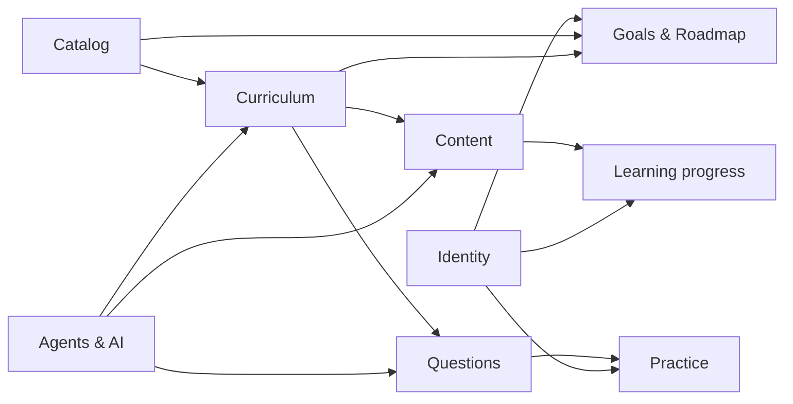
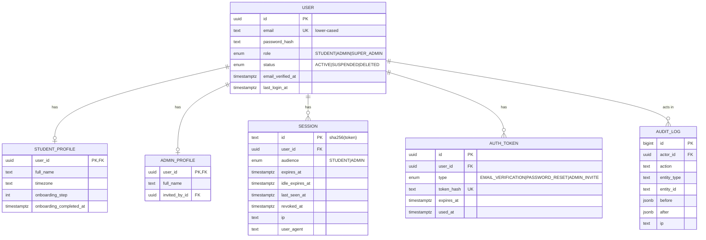
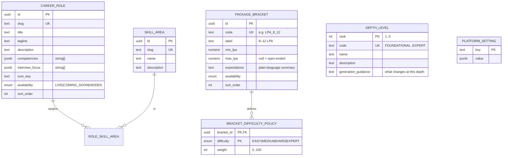
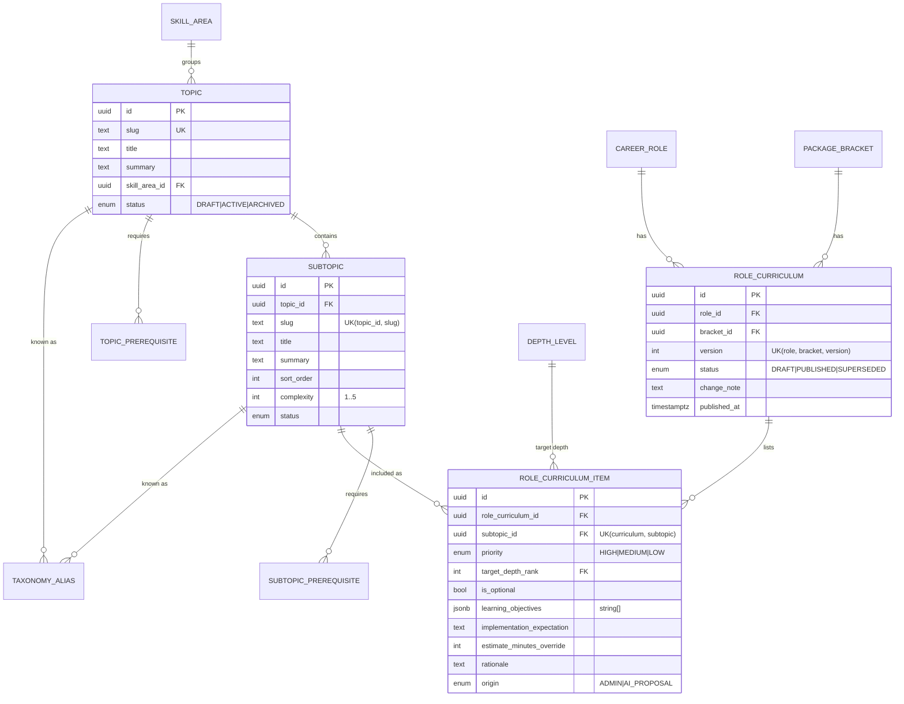
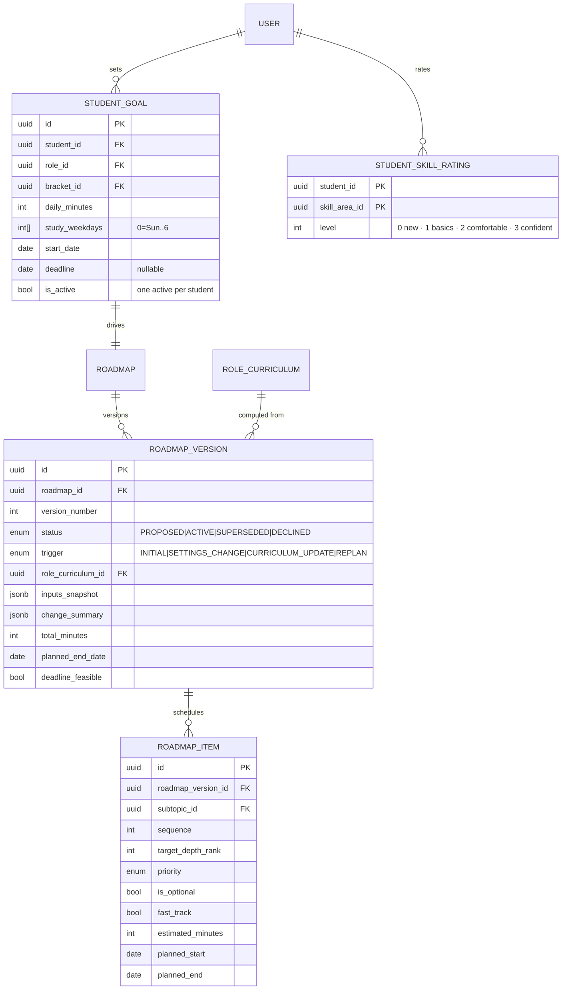
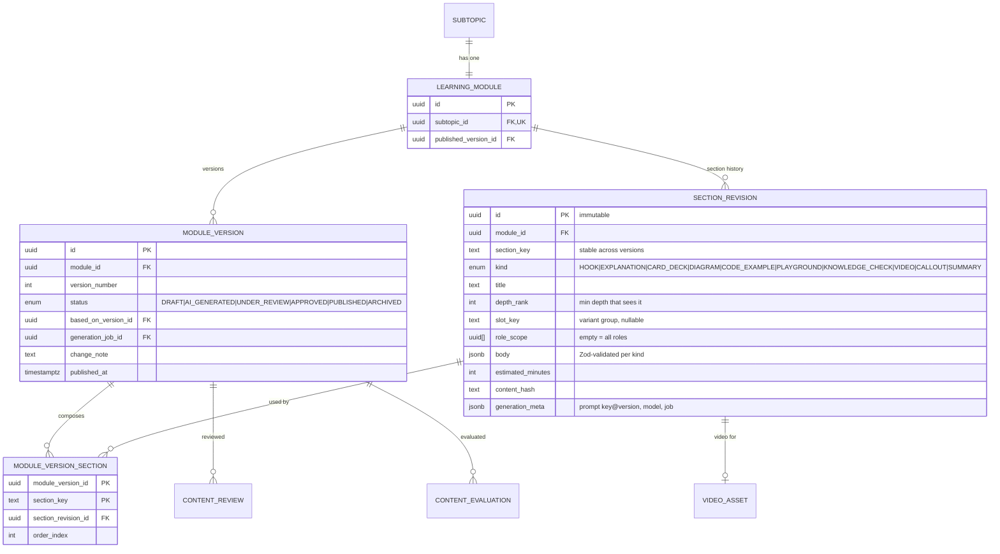
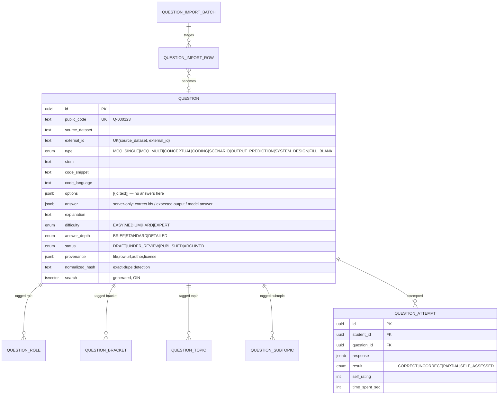

# 03 · Database Design

PostgreSQL 17, managed with Prisma 7 migrations. The source of truth is `apps/api/prisma/schema.prisma`. This document explains the *why* and the shape. Tables are added phase by phase (marked **[P1]**, **[P2]**, …).

## 1. Conventions

| Rule | Detail |
|---|---|
| Primary keys | `uuid` v7 (`@default(uuid(7))`). Time-ordered, so B-tree friendly, and not guessable. Exception: high-volume append-only logs use `bigint` identity. |
| Naming | Prisma models in `PascalCase`, tables and columns in `snake_case` via `@@map` / `@map` |
| Timestamps | `created_at`, `updated_at` on every mutable table. `timestamptz` everywhere. |
| Audit fields | `created_by_id` / `updated_by_id` on admin-managed tables. Full before/after in `audit_log`. |
| Deletes | Soft: `status = ARCHIVED` or `deleted_at`. Hard deletes only for sessions and tokens. |
| Enums | Postgres enums for stable sets (statuses, user role). **Tables** for anything admins configure (roles, brackets, depth levels). |
| JSON | `jsonb` only for *document-shaped* data validated by Zod: section bodies, question options, job I/O, change summaries. Anything we filter or join on is a real column. |
| Multi-tagging | Explicit join tables with composite PKs and reverse indexes. Never comma-separated tags or polymorphic tag tables (keeps FK integrity). |

## 2. Domain overview

The **curriculum taxonomy** (Topic → Subtopic) is the spine. Content modules, questions, roadmap items, progress and analytics all hang off `subtopic_id`. That shared metadata is what connects *Learn* and *Practice*.

---

## 3. Identity [P1]

## 4. Catalog [P2]

## 5. Curriculum [P3]

- **Topics and subtopics are global** and shared across roles. Role and bracket specificity lives in `role_curriculum_item`. This is how "Python" serves both AI Engineers and Data Analysts at different depths without duplication.
- **One published curriculum per role × bracket**, enforced by a partial unique index (`WHERE status = 'PUBLISHED'`). Publishing a new version marks the previous one `SUPERSEDED` and triggers roadmap *proposals*.
- **Prerequisite graph** (`topic_prerequisite`, `subtopic_prerequisite`) is validated acyclic on every write.
- `taxonomy_alias` maps external labels (from datasets, research, job descriptions) to subtopics and topics. It is used by the question importer and research agents.

## 6. Goals and roadmap [P2/P3]

Item *status* (done / in progress / upcoming / delayed) is **derived at read time** from progress and dates, never stored, so it can't go stale.

## 7. Content [P4]

**Why immutable section revisions.** A module version is just an ordered list of pointers to revisions. Regenerating only the coding example creates **one** new revision and a new version that reuses every other pointer. Section history, version diff (compare pointers per `section_key`), rollback and "this lesson changed since you finished it" all become trivial and cheap.

## 8. Learning progress [P4]

| Table | Purpose | Key columns / indexes |
|---|---|---|
| `module_progress` | One row per student × subtopic: resume point and completion | `UK(student_id, subtopic_id)`, `status`, `completed_section_keys text[]`, `last_section_key`, `module_version_id` seen, `time_spent_sec`, `completed_at` |
| `knowledge_check_attempt` | Lesson check answers (reinforcement, **not** practice) | `(student_id, section_revision_id)`, `item_key`, `is_correct`, `response jsonb` |
| `learning_event` | Append-only analytics stream (section viewed, card flipped, code run, video played…) | `bigint` id, `(student_id, created_at)`, `(subtopic_id, type, created_at)`. Monthly partitions at scale. |

## 9. Question bank and practice [P5]

- **Answers live in a separate column (`answer`)** that the student DTO never selects. Leaking the answer before submission is impossible by construction.
- **Near-duplicates** are found with `pg_trgm` similarity on the normalized stem (GIN trigram index). Semantic duplicates (`pgvector`) come later.
- **Empty tag sets mean "unscoped"**: an imported question with no role tag applies to all roles, and one with no bracket tag falls back to the bracket difficulty policy. Admin lists flag untagged questions for review.
- `question_import_row` keeps raw and normalized data, validation errors, duplicate candidates and the admin's decision, so imports are auditable and resumable.

## 10. Agents and AI [P4/P6]

| Table | Purpose |
|---|---|
| `agent_job` | Every async unit of work: `type`, `status`, `input`, `output`, `parent_job_id`, attempts, error, `cost_usd`, tokens, `created_by_id` |
| `agent_job_log` | Step-by-step log lines for a job (`bigint` id) |
| `ai_provider_config` | Provider type, base URL, **env-var name** of the API key (never the key), active flag |
| `ai_model_route` | Task → provider + model + params (temperature, max tokens, timeout, retries) + fallback route |
| `ai_model_pricing` | Per-model token prices (effective-dated) used to compute cost |
| `prompt_template` | `UK(key, version)`, system and user templates, output schema key, status, notes |
| `ai_usage_record` | One row per LLM call: task, model, prompt key@version, tokens, cost, latency, status, job |
| `content_evaluation` | Evaluation Agent report per module version: scores, issues per section, verdict |
| `content_review` | Human decisions: APPROVED / REJECTED / CHANGES_REQUESTED, with notes |
| `research_source` | URL or document, fetch time, hash, robots check, status |
| `research_finding` | Extracted item (topic, skill, question reference, trend) with quote, source and confidence |
| `research_report` | Synthesized report. Every claim is `VERIFIED` (has sources and quotes) or `INFERRED` |
| `curriculum_proposal` | Curriculum Agent output → admin review → materialized into curriculum tables |
| `video_asset` | Script, provider, provider job ID, status, storage key, duration, error |

## 11. Additions from the manager's prototype

| Table | Purpose | Key columns |
|---|---|---|
| `concept` [P3] | Finest skill tag under a subtopic. Links lesson sections, questions and mastery. | `id`, `subtopic_id`, `key` UK (e.g. `rag.chunking.size-tradeoff`), `name`, `description` |
| `section_concept` / `question_concept` [P4/P5] | Many-to-many concept tags | composite PKs + reverse indexes |
| `company` [P2] | "Asked at" companies (Amazon, Swiggy, PhonePe…) | `id`, `slug` UK, `name`, `logo_key` |
| `question_company` [P5] | Company tags **with provenance** | `question_id`, `company_id`, `source` (dataset / URL), `added_by_id` |
| `cohort` / `cohort_member` [P2] | Batches such as "DSML Cohort 7" | `cohort(id, name, starts_on, ends_on)`, `cohort_member(cohort_id, student_id)` |
| `enrollment_allowlist` [P1/P2] | Emails or domains allowed to register under the `ALLOWLIST` policy | `id`, `email` or `domain`, `cohort_id?`, `added_by_id`, `used_at` |
| `learning_module.type` [P4] | `SUBTOPIC_LESSON` \| `QUESTION_PRIMER` \| `CASE_STUDY`. Anchor is `subtopic_id` **or** `question_id` **or** `topic_id` (CHECK constraint: exactly one). | – |
| `case_study_progress` [P7] | Per student × case study: unlocked step, done steps (skipped flag) | `UK(student_id, module_id)` |
| `feedback` [P4] | Thumbs and ratings from students | `id`, `student_id`, `target_type`, `module_version_id?`, `section_key?`, `section_revision_id?`, `question_id?`, `page?`, `thumbs?`, `rating 1–5?`, `tags text[]`, `text`, `created_at` |
| `content_issue` [P8] | Admin triage of feedback clusters | `id`, `target`, `status OPEN\|IN_PROGRESS\|FIXED\|WONTFIX`, `feedback_count`, `assignee_id`, `fix_job_id?` |
| `interest_signal` [P2] | "Notify me" on Next-up / Planned items | `UK(student_id, kind, target_id)`, `notified_at` |
| `question_primer_choice` [P5] | First-visit choice and skip nudge per question (Learn first vs Solve, skip reasons) | `UK(student_id, question_id)`, `choice`, `skip_reasons text[]`, `nudged_at` |
| `external_solve_status` [P5] | Solved status synced from the NxtWave portal | `UK(student_id, question_id)`, `status`, `source`, `synced_at`, `external_ref` |
| `portal_sync_run` [P5] | Each sync execution (Metabase / CSV) | `id`, `source`, `rows_seen`, `rows_matched`, `status`, `error` |

`question` gains: `title`, `suggested_minutes`, `why_asked`, `expected_output`, `follow_ups jsonb`, `solve_mode IN_APP|EXTERNAL_PORTAL`, `external_system`, `external_id` (portal `s_id`), `datasets jsonb`.
`career_role.availability` / `package_bracket.availability` / `topic.availability` use `LIVE | NEXT_UP | PLANNED | HIDDEN`.

## 12. Key indexes (summary)

| Query | Index |
|---|---|
| Session lookup per request | PK on `session.id` (token hash) |
| Student's active goal and roadmap | `student_goal(student_id) WHERE is_active` |
| Published curriculum for role × bracket | partial unique `(role_id, bracket_id) WHERE status='PUBLISHED'` |
| Practice retrieval | `question_subtopic(subtopic_id, question_id)`, `question(status, difficulty)`, role and bracket join reverse indexes |
| Question search | GIN on `question.search`, GIN trigram on normalized stem |
| Student progress views | `module_progress(student_id)`, `question_attempt(student_id, created_at)` |
| Admin student filters | `student_goal(role_id, bracket_id)`, `module_progress(subtopic_id, status)` |
| Analytics | `learning_event(subtopic_id, type, created_at)` |

## 13. Data lifecycle
- Sessions and tokens: purged daily after expiry.
- `learning_event`: 18 months hot, then archived or aggregated.
- Account deletion: the user row is anonymized (email → hash), and events and attempts are kept anonymized for aggregate analytics.
